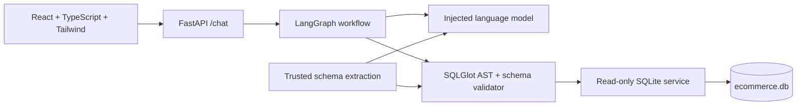
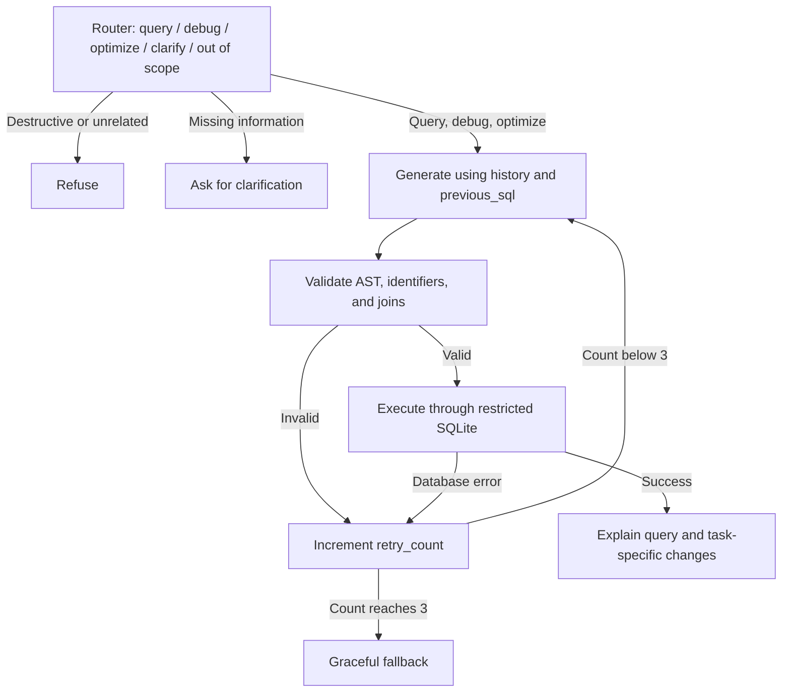

# QueryDesk

A conversational SQL assistant for a small ecommerce database. Ask a question,
refine it in a follow-up, or paste a query for debugging or optimization. Generated
SQL is checked with SQLGlot and executed through an independently restricted SQLite
connection before it is returned to the browser.

**Submission status:** source, tests, Docker images, and deployment configuration
are available. A live public URL and the final demo video are **not yet available**.
Live model testing needs `LLM_API_KEY` and `LLM_MODEL`; publishing needs a hosting
account. No model responses are simulated in the application.

## Run with Docker

Requires Docker Desktop or Docker Engine with Compose.

```sh
cp .env.example .env
# Set LLM_API_KEY and LLM_MODEL in .env. Change LLM_BASE_URL if necessary.
docker compose up --build -d
```

On PowerShell, use `Copy-Item .env.example .env` for the first command.
Open **http://localhost:8080**. API documentation is at **http://localhost:8000/docs**.
The image includes a seeded database. No database server, login, or manual migration
is needed. Without model credentials the UI and schema load, but chat reports that
model setup is required.

```sh
docker compose down
```

## Run locally

Requires Python 3.10+ and Node.js 22.12+. Run backend commands from the repository root.

### Backend — PowerShell

```powershell
python -m venv .venv
.\.venv\Scripts\python -m pip install -r backend/requirements-dev.txt
.\.venv\Scripts\python -m pip install --no-deps -e backend
Copy-Item .env.example .env
.\.venv\Scripts\python backend/seed_db.py
.\.venv\Scripts\python -m uvicorn app.main:create_app --factory --reload
```

### Backend — macOS/Linux

```sh
python3 -m venv .venv
.venv/bin/python -m pip install -r backend/requirements-dev.txt
.venv/bin/python -m pip install --no-deps -e backend
cp .env.example .env
.venv/bin/python backend/seed_db.py
.venv/bin/python -m uvicorn app.main:create_app --factory --reload
```

### Frontend — separate terminal

```sh
cd frontend
npm ci
npm run dev
```

Open **http://localhost:5173**. Vite proxies `/api` to the backend on port 8000.
For a separately hosted frontend, set `VITE_API_URL` at build time and add its origin
to backend `CORS_ORIGINS`. Use `npm.cmd` instead of `npm` if PowerShell blocks npm's script.

## Configuration

| Variable | Default | Purpose |
| --- | --- | --- |
| `LLM_API_KEY` | empty | Backend-only model credential; never sent to the frontend |
| `LLM_MODEL` | empty | Model ID from your chosen provider |
| `LLM_BASE_URL` | `https://api.openai.com/v1` | OpenAI-compatible chat-completions base URL |
| `LLM_TIMEOUT_SECONDS` | `30` | Deadline for each provider request |
| `DATABASE_PATH` | `./ecommerce.db` | Existing SQLite file; containers set their own absolute path |
| `QUERY_TIMEOUT_SECONDS` | `2` | SQLite progress-handler deadline |
| `QUERY_ROW_LIMIT` | `200` | Returned row cap, with visible truncation status |
| `CORS_ORIGINS` | `["http://localhost:5173"]` | JSON array of allowed frontend origins |
| `FRONTEND_DIST` | unset | Optional static frontend directory for single-service deployment |

The provider must support `/chat/completions`, JSON-object response mode, and
`max_tokens`. The adapter is replaceable through the `LanguageModel` protocol;
nodes do not depend on a vendor SDK. Conversation and schema context are sent to
the configured provider; result rows are not sent for explanation.

## Architecture



```text
backend/
  app/api/        Routes and dependency resolution
  app/agent/      State import, graph, single-purpose nodes, prompts
  app/services/   SQL validation, schema extraction, database execution, LLM adapter
  app/models/     Pydantic input/output schemas and AgentState TypedDict
  tests/          Validator, database, graph, and HTTP tests
  seed_db.py      Separate sample-data writer
frontend/
  src/components/ ChatWindow, SQLPanel, ExplanationBox, ResultsTable
  src/hooks/      Conversation state and request cancellation
  src/services/   Typed API client and safe CSV export
docs/             Schema, workflow/design notes, demo script, evaluation checklist
```

### LangGraph validation loop



One initial attempt and two repair attempts are permitted. Every failed validation
or execution increments the same counter exactly once. The next generator call gets
the failed SQL and explicit error, alongside the original request. A separate graph
recursion limit guards unexpected control-flow bugs. Provider failures return a 503
instead of pretending that a SQL correction can repair model availability.

Generation uses intent-specific instructions for ordinary questions, debugging,
and optimization. Every resulting candidate goes through the same validation and
execution path. Debugging includes an explanation of the original error; optimization
provides prose suggestions without index-creation DDL. See the actual
[prompts](backend/app/agent/prompts.py) and [design notes](docs/architecture.md).

### Safety controls and deliberate limits

1. Parse all statements with `sqlglot.parse(..., read="sqlite")`; require exactly one
   statement whose root is `Select`. Reject writes, commands, external sources, and
   nested DML/DDL. A successful parse alone is not treated as proof of executable SQL.
2. Resolve aliases, CTEs, subqueries, and columns against the extracted schema. Joins
   must connect sources through declared foreign-key equalities. Cartesian joins,
   recursive CTEs, and unsupported relationship patterns are rejected.
3. Execute with a fresh `mode=ro` connection, extension loading disabled, and a
   deny-by-default authorizer. Only `SQLITE_SELECT` and application-table
   `SQLITE_READ` actions are allowed. System tables and attached databases are blocked.
4. Use a progress-handler deadline and fetch at most one row beyond the display cap.
   The response reports truncation. Connection lock timeout is configured separately
   from the execution progress check.
5. Return SQL only after validation and execution succeed. Rejected candidates stay
   internal. Client messages cannot supply a system role; history and previous SQL
   remain untrusted context. CSV exports escape formulas and quoted cells.

**The requested two-action authorizer blocks SQL functions**, including `COUNT`,
`SUM`, `AVG`, date functions, and `LOWER`. Such requests cannot currently produce
successful analytics results. Enabling them requires explicit approval for a small
`SQLITE_FUNCTION` allowlist. The application does not silently relax this requirement.
Top-level `UNION`, `INTERSECT`, `EXCEPT`, and `EXPLAIN` are also rejected by the
SELECT-root rule. These are intentional supported-language limits, not claims that
those operations are inherently destructive.

Guardrails prevent writes; they do not prove that every LLM interpretation matches
business intent. Live model accuracy must be checked with the evaluation cases below.

## Database

The deterministic seed contains 28 fictional rows: 6 users, 6 products, 6 orders,
and 10 order items. `Users.state` supports the California follow-up example.
`Orders.user_id`, `OrderItems.order_id`, and `OrderItems.product_id` declare relationships.
Prices use integer cents; timestamps use ISO date strings. Current product prices
and historical item prices are separate fields.

The seed script preserves an existing sample database and refuses to overwrite an
unexpected schema. See [sample DDL](docs/schema.sql). The generated `.db` file is
ignored by Git and reproduced locally or during the image build.

## API

`POST /chat` accepts:

```json
{
  "message": "Only California",
  "history": [
    {"role": "user", "content": "Show all customers"},
    {"role": "assistant", "content": "Here are the customers.", "sql": "SELECT name, state FROM Users"}
  ],
  "previous_sql": "SELECT name, state FROM Users"
}
```

Responses include `status`, `intent`, `generated_sql`, `is_valid`, `retry_count`,
`explanation`, `original_error`, `optimization_tips`, and positional `query_results`.
Status is `success`, `clarification`, `rejected`, or `error`. SQL is null for
unsuccessful responses. `/schema` exposes the sample schema; `/health` reports
database readiness and model configuration presence. `/api/*` aliases support the
single-service image. Model configuration presence is not a live-provider health test.

Conversation history lives in browser memory and is sent with each turn. This avoids
shared server conversation state and cross-user leakage; a page refresh starts a new
conversation. Selecting an older result only changes the displayed result, not the
latest conversational query. New conversation aborts pending client requests.

## Verification

```powershell
.\.venv\Scripts\python -m pytest backend/tests -q
.\.venv\Scripts\python -m ruff check backend
cd frontend
npm run build
npm test
```

Current checks: **70 backend tests and 7 frontend tests**. Backend tests use the real
seeded SQLite database and a scripted model, including repair after AST/schema and
SQLite errors. Frontend tests exercise the actual HTTP client with controlled
responses. These tests do not establish live LLM accuracy.

With the API and frontend running, `node scripts/browser-smoke.mjs` from `frontend/`
checks desktop/mobile layout, schema loading, results, refusal, reset, and overflow.
It uses installed Microsoft Edge by default; set `BROWSER_CHANNEL=chrome` if needed.
Chat responses in that browser test are explicitly HTTP fixtures. Screenshots go to
the ignored `artifacts/browser/` directory. CI runs backend tests and frontend build/tests.

See [evaluation cases](docs/evaluation.md) for live model acceptance checks.

## Public deployment

The root `Dockerfile` serves React and FastAPI from one service, avoiding separate
frontend/backend domains. It includes the read-only sample database, runs as a
non-root user, and listens on the platform's `PORT` variable.

1. Create a Render Blueprint using this repository and its `render.yaml`, or use
   [Deploy to Render](https://render.com/deploy?repo=https://github.com/Mainamanhoon/SQL-Query-AI-Agent).
2. Set `LLM_API_KEY` and `LLM_MODEL` in the hosting dashboard. Update `LLM_BASE_URL`
   for your provider. Never commit credentials.
3. After deployment, open the assigned public URL and run the live evaluation cases.
4. Record the verified public URL here and in the assignment submission.

The Blueprint uses Render's documented Docker, health-check, and secret-variable
settings: [Blueprint reference](https://render.com/docs/blueprint-spec).

**Public application URL:** pending hosting configuration and verification.
**Demo video:** pending a configured live model; recording outline in
[docs/demo-script.md](docs/demo-script.md). A deploy button is not a deployed application.

## Assumptions

- The assignment PDF supplies no concrete schema, so the requested four-table
  ecommerce schema is the source of truth. “Customers” means rows in `Users`.
- This is a sample-data assignment app, not an authenticated multi-tenant product.
- SQLite is the only supported SQL dialect. Streaming and multiple dialects were
  not added because correctness and the required guardrails take priority.
- Optimization recommendations are not presented as measured performance gains.
- The strict function restriction remains in place until explicitly changed.
