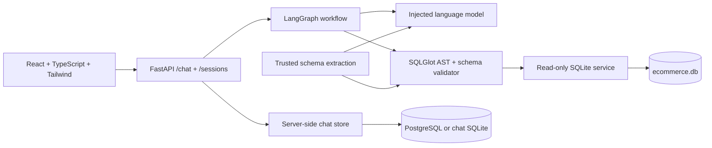
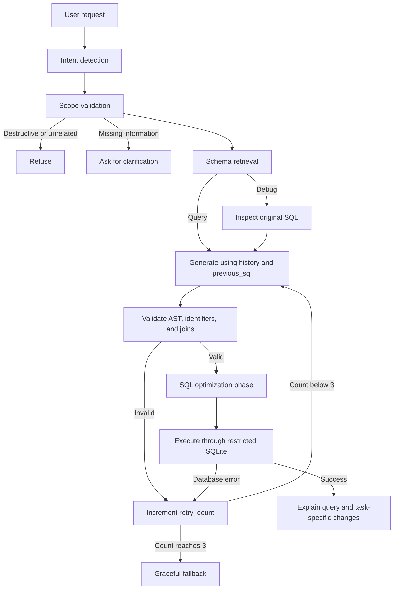

# QueryDesk

A conversational SQL assistant for a small ecommerce database. Ask a question,
refine it in a follow-up, or paste a query for debugging or optimization. Generated
SQL is checked with SQLGlot and executed through an independently restricted SQLite
connection before it is returned to the browser.

Source, tests, and Docker images are included. No model responses are simulated in
the application.

## Setup and run

The project runs as a Docker Compose stack. The backend owns the model key; the
frontend never receives it.

### 1. Configure the model

Create a local environment file and set a model supported by your OpenAI-compatible
provider. For OpenRouter, for example:

PowerShell:

```powershell
Copy-Item .env.example .env
notepad .env
```

macOS/Linux:

```sh
cp .env.example .env
nano .env
```

```dotenv
LLM_API_KEY=your-provider-key
LLM_BASE_URL=https://openrouter.ai/api/v1
LLM_MODEL=deepseek/deepseek-v4.1-flash
LLM_MAX_TOKENS=1000
CHAT_DATABASE_URL=sqlite:///./chat_sessions.db
```

For Vercel, set `CHAT_DATABASE_URL` to a managed PostgreSQL connection string
(Supabase, Neon, or another PostgreSQL provider). Vercel's function filesystem is
ephemeral, so its chat sessions must not use the local SQLite default.

### 2. Run with Docker Compose

Requires Docker Desktop or Docker Engine with Compose. From the repository root:

```sh
docker compose up --build -d
```

Compose starts the backend on port 8000 and the Vite frontend on port 8080. Open
`http://localhost:8080`; API docs remain at `http://localhost:8000/docs`.
The backend image seeds its own database during the image build, so no database
server or migration command is required. View logs or stop the stack with:

```sh
docker compose logs -f
docker compose down
```

## Configuration

| Variable | Default | Purpose |
| --- | --- | --- |
| `LLM_API_KEY` | empty | Backend-only model credential; never sent to the frontend |
| `LLM_MODEL` | `deepseek/deepseek-v4.1-flash` | OpenRouter model ID |
| `LLM_BASE_URL` | `https://openrouter.ai/api/v1` | OpenAI-compatible chat-completions base URL |
| `LLM_TIMEOUT_SECONDS` | `30` | Deadline for each provider request |
| `LLM_MAX_TOKENS` | `1000` | Maximum completion budget per model call |
| `DATABASE_PATH` | `./ecommerce.db` | Existing SQLite file; containers set their own absolute path |
| `CHAT_DATABASE_URL` | `sqlite:///./chat_sessions.db` | Separate chat store; use managed PostgreSQL on Vercel |
| `QUERY_TIMEOUT_SECONDS` | `2` | SQLite progress-handler deadline |
| `QUERY_ROW_LIMIT` | `200` | Returned row cap, with visible truncation status |
| `CORS_ORIGINS` | `["http://localhost:5173"]` | JSON array of allowed frontend origins |

The provider must support `/chat/completions`, JSON-object response mode, and
`max_tokens`. The adapter is replaceable through the `LanguageModel` protocol;
nodes do not depend on a vendor SDK. Conversation and schema context are sent to
the configured provider; result rows are not sent for explanation.

## Architecture



```text
backend/
  app/api/        Routes and dependency resolution
  app/agent/      State import, graph, single-purpose nodes, prompts
  app/services/   SQL validation, schema extraction, database execution, LLM adapter
  app/models/     Pydantic input/output schemas and AgentState TypedDict
  tests/          Validator, database, graph, and HTTP tests
  seed_db.py      Separate sample-data writer
frontend/
  src/components/ ChatWindow, SQLPanel, ExplanationBox, ResultsTable
  src/hooks/      Conversation state and request cancellation
  src/services/   Typed API client and safe CSV export
docs/             Schema, workflow/design notes, demo script, evaluation checklist
```

### LangGraph validation loop



One initial attempt and two repair attempts are permitted. Every failed validation
or execution increments the same counter exactly once. The next generator call gets
the failed SQL and explicit error, alongside the original request. A separate graph
recursion limit guards unexpected control-flow bugs. Provider failures return a 503
instead of pretending that a SQL correction can repair model availability.

Generation uses intent-specific instructions for ordinary questions, debugging,
and optimization. Every resulting candidate goes through the same validation and
execution path. Debugging includes an explanation of the original error; optimization
provides prose suggestions without index-creation DDL. See the actual
[prompts](backend/app/agent/prompts.py) and [design notes](docs/architecture.md).

### Safety controls and deliberate limits

1. Parse all statements with `sqlglot.parse(..., read="sqlite")`; require exactly one
   statement whose root is `Select`. Reject writes, commands, external sources, and
   nested DML/DDL. A successful parse alone is not treated as proof of executable SQL.
2. Resolve aliases, CTEs, subqueries, and columns against the extracted schema. Joins
   must connect sources through declared foreign-key equalities. Cartesian joins,
   recursive CTEs, and unsupported relationship patterns are rejected.
3. Execute with a fresh `mode=ro` connection, extension loading disabled, and a
   deny-by-default authorizer. It allows `SQLITE_SELECT`, application-table
   `SQLITE_READ`, and an explicit allowlist of read-only SQL functions for analytics.
   System tables, attached databases, extension loading, and write actions are blocked.
4. Use a progress-handler deadline and fetch at most one row beyond the display cap.
   The response reports truncation. Connection lock timeout is configured separately
   from the execution progress check.
5. Return SQL only after validation and execution succeed. Rejected candidates stay
   internal. Client messages cannot supply a system role; history and previous SQL
   remain untrusted context. CSV exports escape formulas and quoted cells.

The function allowlist covers common read-only aggregates, window functions, string,
numeric, date/time, and JSON functions. SQLGlot checks the same allowlist before
execution, while the SQLite authorizer enforces it again at the database boundary.
Top-level `UNION`, `INTERSECT`, `EXCEPT`, and `EXPLAIN` are also rejected by the
SELECT-root rule. These are intentional supported-language limits, not claims that
those operations are inherently destructive.

Guardrails prevent writes; they do not prove that every LLM interpretation matches
business intent. Live model accuracy must be checked with the evaluation cases below.

## Database

The deterministic seed contains 28 fictional rows: 6 users, 6 products, 6 orders,
and 10 order items. `Users.state` supports the California follow-up example.
`Orders.user_id`, `OrderItems.order_id`, and `OrderItems.product_id` declare relationships.
Prices use integer cents; timestamps use ISO date strings. Current product prices
and historical item prices are separate fields.

The seed script preserves an existing sample database and refuses to overwrite an
unexpected schema. See [sample DDL](docs/schema.sql). The generated `.db` file is
ignored by Git and reproduced locally or during the image build.

## API

`POST /chat` accepts:

```json
{
  "message": "Only California",
  "history": [
    {"role": "user", "content": "Show all customers"},
    {"role": "assistant", "content": "Here are the customers.", "sql": "SELECT name, state FROM Users"}
  ],
  "previous_sql": "SELECT name, state FROM Users"
}
```

Responses include `status`, `intent`, `dialect`, `generated_sql`, `is_valid`,
`retry_count`, `explanation`, `original_error`, `optimization_tips`, and positional
`query_results`. Each result includes a deterministic SQLite `cost_estimate` based on
`EXPLAIN QUERY PLAN`.
`POST /chat/stream` accepts the same body and emits `status`, explanation `chunk`,
and final `complete` SSE events; the final event is the same guarded response.
Status is `success`, `clarification`, `rejected`, or `error`. SQL is null for
unsuccessful responses. `/run-sql` accepts SQL from the editor and validates and
executes it through the same SQLGlot and read-only SQLite guardrails without an LLM
call. Both `/chat` and `/run-sql` accept `dialect` as `sqlite`, `postgresql`, or `mysql`;
non-SQLite read-only input is validated with SQLGlot and transpiled to SQLite before
execution. `/schema` exposes the sample schema; `/health` reports database readiness and
model configuration presence. `/api/*` aliases support the frontend proxy. Model
configuration presence is not a live-provider health test.

`GET /sessions` lists sessions for the `X-Client-ID` header. `PUT /sessions/{id}`
upserts one bounded session and `DELETE /sessions/{id}` removes it. The frontend
generates this opaque identifier once and sends it automatically; no model call is
made by any session endpoint.

Conversation sessions are persisted server-side through `/sessions`, keyed by an
opaque `X-Client-ID` retained in the browser. The backend keeps at most 20 sessions
and 60 messages per client, and `/chat` loads the stored session before generating a
follow-up. The browser's `querydesk.sessions.v1` local-storage value is only a cache
for startup/offline continuity; it is not the source of truth. This anonymous client
identifier is not authentication—add account authentication before treating sessions
as private user data. Selecting an older session restores its messages and previous
SQL; a new conversation starts a separate server session.

The UI also supports persisted dark mode, copy/download SQL, CSV result downloads,
SQLite query-plan cost estimates, loading/error states, and streamed explanation text.
The Docker Compose stack mounts a writable `chat_data` volume for local SQLite chat
storage. For Vercel, configure `CHAT_DATABASE_URL` with a managed PostgreSQL URL in
the backend project's Environment Variables and redeploy the backend.

### Bonus coverage

| Feature | Implementation |
| --- | --- |
| SQL execution | Guarded `/run-sql` endpoint and automatic execution against the seeded database |
| Follow-up questions | Server-side sessions, bounded history, and `previous_sql` state |
| Query cost estimation | SQLite `EXPLAIN QUERY PLAN` summary shown with every result |
| Syntax highlighting | SQL-aware `react-syntax-highlighter` editor panel |
| Multiple dialects | SQLGlot validation/transpilation for SQLite, PostgreSQL, and MySQL read-only SQL |
| CSV export | Formula-safe client-side CSV download for result rows |
| Prompt injection protection | Deterministic scope checks, isolated system prompts, AST validation, and DB authorizer |
| Docker deployment | Backend/frontend Dockerfiles and a Docker Compose stack |
| Tests | Backend unit/integration tests plus frontend unit tests and browser smoke checks |

## Verification

```powershell
.\.venv\Scripts\python -m pytest backend/tests -q
.\.venv\Scripts\python -m ruff check backend
cd frontend
npm run build
npm test
```

Current checks: **97 backend tests and 11 frontend tests**. Backend tests use the real
seeded SQLite database and a scripted model, including repair after AST/schema and
SQLite errors. Frontend tests exercise the actual HTTP client with controlled
responses. These tests do not establish live LLM accuracy.

With the API and frontend running, `node scripts/browser-smoke.mjs` from `frontend/`
checks desktop/mobile layout, schema loading, results, refusal, reset, and overflow.
It uses installed Microsoft Edge by default; set `BROWSER_CHANNEL=chrome` if needed.
Chat responses in that browser test are explicitly HTTP fixtures. Screenshots go to
the ignored `artifacts/browser/` directory. CI runs backend tests and frontend build/tests.

See [evaluation cases](docs/evaluation.md) for live model acceptance checks.

## Assumptions

- The assignment PDF supplies no concrete schema, so the requested four-table
  ecommerce schema is the source of truth. “Customers” means rows in `Users`.
- This is a sample-data assignment app, not an authenticated multi-tenant product.
- SQLite is the execution database. PostgreSQL and MySQL read-only syntax is accepted
  at the API boundary, validated with the requested SQLGlot dialect, and transpiled to
  safe SQLite before execution. The `/chat/stream` endpoint streams progress and
  explanation text; SQL and rows are sent only after final validation and execution.
- Optimization recommendations are not presented as measured performance gains.
- Read-only SQL functions are limited to the shared explicit allowlist in
  `backend/app/services/sql_policy.py`.
